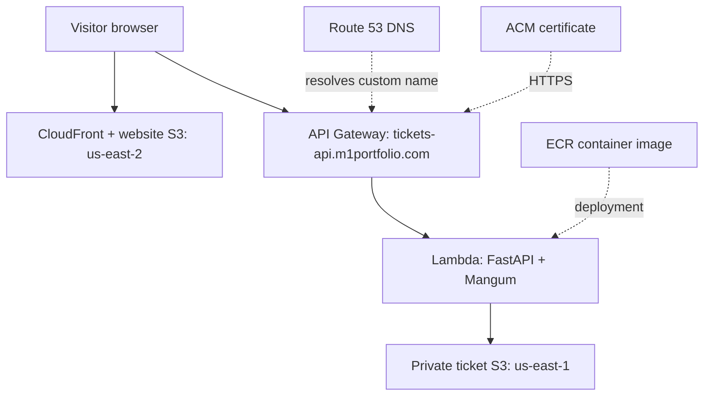

# Live Ticket API Demo: AWS + Terraform + Portfolio Integration

A support-ticket API you can switch **on and off** with one command and a reviewed Terraform apply, linked as a live demo page from m1portfolio.com. Visitors generate synthetic tickets, the API validates them and stores them in S3, and everything is deployed with Terraform.

> Revised 2026-10-20 following the completed build reported by Miles. Includes the OPTIONS preflight fix in the application and tests. Existing builders: do not recreate working resources or restart the lab. For an older deployment, use the upgrade procedure in Step 7E; new builders follow Steps 1–14. Review the earlier corrections when maintaining your local files. This document contains code to copy; downloading the README does not create those files on your PC.
>
> Commands use local Windows PowerShell from the project root unless stated otherwise. Run commands individually and stop on errors. This revision has been checked locally; AWS deployment and your existing CloudFront configuration still require the verification steps below.

Every step has three parts:

- **Do:** what to run or write
- **Why:** the reasoning, so you can defend the choice
- **Say it:** a one-sentence version for an interview

This builds on the first ticket-API lab. The validation, storage, and test code carry over; what's new is Lambda packaging, Terraform, the public-facing guardrails, and the website widget.

## The big picture



The browser fetches the website and separately calls the API. Route 53 resolves DNS; ACM supplies the certificate rather than acting as a traffic hop. CloudWatch alarms publish to SNS; an account budget emails cost alerts.

### Design decisions (know these cold)

| Decision | Why |
|---|---|
| **Lambda + API Gateway** instead of ECS + ALB | Pay per request, so an idle demo costs about nothing. An ALB bills every hour whether anyone visits or not. |
| **Docker image on Lambda** | Keeps the container story and ECR, with no servers to manage. Fargate would require a web-server entry point such as Uvicorn; this Lambda image is not a drop-in Fargate server. |
| **Separate subdomain** (`tickets-api.`) | The new stack stays independent from your site stack, reducing coupling; shared DNS and site settings still need careful review. |
| **S3 for storage** | Reuses the first lab's storage code. One object per ticket suits a demo; a real system would use a database. |
| **Public endpoint, synthetic data only** | Anyone on the internet can call it, so every guardrail below exists because of that fact. |

> **About "on/off":** because Lambda and API Gateway cost almost nothing while idle, the switch is mainly a **safety and control** feature (stop Lambda execution, show the site gracefully degrading), not a cost saver. Say that honestly in interviews. It's a stronger answer than pretending it saves money.

| Layer | Files |
|---|---|
| App | `app/models.py`, `app/storage.py`, `app/main.py` |
| Container | `Dockerfile` |
| Infrastructure | `terraform/*.tf` |
| Website | `web/ticket-demo.html`, `web/ticket-demo.css`, `web/ticket-demo.js` |
| Operations | `scripts/demo.ps1`, `scripts/demo.sh` |

## Prerequisites

- Python 3.12 (to match the container), Docker Desktop with Linux containers, Terraform 1.10+, AWS CLI configured (`aws sts get-caller-identity` works)
- Your Route 53 hosted zone for `m1portfolio.com` (already exists from the site stack)
- An email address for alerts
- **Windows/PowerShell** is the primary shell below; bash differences are noted where they matter

---

## Step 1: Project setup

**Do**

```powershell
mkdir ticket-live-demo; cd ticket-live-demo
git init
mkdir app, tests, terraform, web, scripts
New-Item app\__init__.py -ItemType File
py -3.12 -m venv .venv
.venv\Scripts\Activate.ps1          # bash: source .venv/bin/activate
```

Create these three files in the project root (the top `ticket-live-demo` folder), one at a time, and paste in the contents shown.

`requirements.txt` (what the deployed app needs)

```
fastapi
mangum
boto3
pydantic>=2
```

`requirements-dev.txt` (adds the tools you only need for testing)

```
-r requirements.txt
pytest
httpx
moto[s3]
uvicorn
```

`pytest.ini` (tells pytest where your code is)

```ini
[pytest]
pythonpath = .
```

```powershell
.\.venv\Scripts\python.exe -m pip install -r requirements-dev.txt
```

Two more small files in the project root:

`.gitignore` (keeps secrets and junk out of Git)

```
.venv/
__pycache__/
.pytest_cache/
.terraform/
*.tfstate
*.tfstate.*
*.tfplan
*.auto.tfvars.json
.venv-backup*/
terraform.tfvars
crash.log
```

`.dockerignore` (keeps tests, Terraform, and docs out of the Docker image)

```
.venv
.git
tests
terraform
web
scripts
evidence
.venv-backup*
.env*
__pycache__
*.md
```

**Why**

- **Two requirements files:** the Lambda image only needs runtime packages. Test tools stay out, so the image is smaller and has less to exploit.
- **`.gitignore` for state and tfvars:** Terraform state can contain secrets and account details. Committing it to a public repo is a classic, avoidable leak.
- **`mangum`** is new compared with the first lab: the adapter that lets FastAPI run inside Lambda (Step 2).

**Say it:** "I keep test tooling out of the production image and keep Terraform state out of version control."

---

### Python launcher troubleshooting

If bare `pip` references a missing Python executable, use the explicit `.venv` Python command above. Check installed versions with `py -0p`. If the existing virtual environment is broken, close terminals using it and open a fresh PowerShell window in the project root. Preserve it and recreate:

```powershell
if (Test-Path .\.venv) {
    Rename-Item .\.venv -NewName ".venv-backup-$(Get-Date -Format 'yyyyMMdd-HHmmss')"
}
py -3.12 -m venv .venv
.\.venv\Scripts\python.exe -m pip install --upgrade pip
.\.venv\Scripts\python.exe -m pip install -r requirements-dev.txt
```

Stop on errors. Install Python 3.12 if it is not listed. Do not uninstall unrelated Python versions.

## Step 2: Application code

**Do:** create the three app files. Keep the OPTIONS handler shown below: it prevents the browser-only 405 failure encountered during this build. POST can work in PowerShell while browser preflight still fails.

`app/models.py`

```python
from datetime import datetime
from enum import Enum
from pydantic import BaseModel, Field, field_validator


class Priority(str, Enum):
    low = "low"
    medium = "medium"
    high = "high"


class TicketCreate(BaseModel):
    description: str = Field(max_length=2000)
    priority: Priority = Priority.medium

    @field_validator("description")
    @classmethod
    def not_blank(cls, v: str) -> str:
        v = v.strip()
        if len(v) < 10:
            raise ValueError("description must be at least 10 characters")
        return v


class Ticket(TicketCreate):
    id: str
    status: str = "open"
    created_at: datetime
```

`app/storage.py`

```python
import os
import boto3
from botocore.exceptions import BotoCoreError, ClientError
from .models import Ticket


class StorageError(Exception):
    """Any AWS-side failure."""


class TicketNotFound(Exception):
    pass


class TicketStore:
    def __init__(self, bucket: str | None = None, client=None):
        self.bucket = bucket or os.environ["TICKET_BUCKET"]
        self.s3 = client or boto3.client("s3")

    def _key(self, ticket_id: str) -> str:
        return f"tickets/{ticket_id}.json"

    def put(self, ticket: Ticket) -> None:
        try:
            self.s3.put_object(
                Bucket=self.bucket,
                Key=self._key(ticket.id),
                Body=ticket.model_dump_json().encode(),
                ContentType="application/json",
            )
        except (ClientError, BotoCoreError) as e:
            raise StorageError(str(e)) from e

    def get(self, ticket_id: str) -> Ticket:
        try:
            obj = self.s3.get_object(Bucket=self.bucket, Key=self._key(ticket_id))
            return Ticket.model_validate_json(obj["Body"].read())
        except ClientError as e:
            if e.response["Error"]["Code"] in ("NoSuchKey", "404"):
                raise TicketNotFound(ticket_id) from e
            raise StorageError(str(e)) from e
        except BotoCoreError as e:
            raise StorageError(str(e)) from e
```

`app/main.py`

```python
import logging
import os
import uuid
from datetime import datetime, timezone
from functools import lru_cache

from fastapi import Depends, FastAPI, HTTPException
from fastapi.responses import JSONResponse, Response
from mangum import Mangum

from .models import Ticket, TicketCreate
from .storage import StorageError, TicketNotFound, TicketStore

logger = logging.getLogger("ticket-api")
logger.setLevel(logging.INFO)

# Interactive docs are off by default: less public attack surface.
# Set ENABLE_DOCS=1 for local development.
_docs = os.environ.get("ENABLE_DOCS") == "1"
app = FastAPI(
    title="Support Ticket API",
    docs_url="/docs" if _docs else None,
    redoc_url=None,
    openapi_url="/openapi.json" if _docs else None,
)


@lru_cache
def get_store() -> TicketStore:
    return TicketStore()


@app.exception_handler(StorageError)
async def storage_error_handler(_, exc: StorageError):
    logger.error("storage failure: %s", exc)  # detail stays in our logs
    return JSONResponse(status_code=502, content={"error": "storage_unavailable"})


@app.get("/health")
def health():
    return {"status": "ok"}


# The API Gateway $default integration can forward OPTIONS to this app.
# Return a successful preflight status; API Gateway supplies the CORS headers.
@app.options("/tickets", include_in_schema=False)
def tickets_preflight():
    return Response(status_code=204)


@app.post("/tickets", response_model=Ticket, status_code=201)
def create_ticket(body: TicketCreate, store: TicketStore = Depends(get_store)):
    ticket = Ticket(
        id=str(uuid.uuid4()),
        created_at=datetime.now(timezone.utc),
        **body.model_dump(),
    )
    store.put(ticket)
    return ticket


@app.get("/tickets/{ticket_id}", response_model=Ticket)
def get_ticket(ticket_id: uuid.UUID, store: TicketStore = Depends(get_store)):
    try:
        return store.get(str(ticket_id))
    except TicketNotFound:
        raise HTTPException(status_code=404, detail="ticket not found")


# AWS Lambda entry point: translates API Gateway events into ASGI calls.
handler = Mangum(app, lifespan="off")
```

**Why**

Unchanged from the first lab, and still the core of your explanation:

- **Validate at the boundary:** bad input is rejected before it reaches S3. The 2,000-character cap also stops anyone filling your bucket with huge objects.
- **`TicketCreate` vs `Ticket`:** clients send only description and priority. The server owns `id`, `status`, and `created_at`.
- **Storage layer wraps boto3 errors:** the API never imports AWS code, and "not found" (404) stays separate from "infrastructure failed" (502).
- **Generic 502 body, detailed log:** clients learn nothing about your AWS setup, and you still get the detail in CloudWatch.

New in this version:

- **`handler = Mangum(app, lifespan="off")`:** Lambda doesn't speak HTTP. API Gateway hands it a JSON event, and Mangum translates that event into a normal web request for FastAPI and translates the response back. `lifespan="off"` skips startup hooks that don't map to Lambda's lifecycle.
- **Docs disabled by default:** `/docs` and `/openapi.json` hand attackers a map of your API. On a public endpoint, expose only what's needed. Set `ENABLE_DOCS=1` locally if you want them.

**Say it:** "Mangum adapts API Gateway events to FastAPI, and I turned off the auto-generated docs because the endpoint is public."

---

## Step 3: Tests

**Do:** create `tests/test_api.py`, then run it.

```python
import boto3
import pytest
from botocore.stub import Stubber
from fastapi.testclient import TestClient
from moto import mock_aws

from app.main import app, get_store
from app.storage import TicketStore

BUCKET = "test-tickets"
FAKE_ID = "123e4567-e89b-12d3-a456-426614174000"


@pytest.fixture
def client():
    with mock_aws():
        s3 = boto3.client("s3", region_name="us-east-1")
        s3.create_bucket(Bucket=BUCKET)
        store = TicketStore(bucket=BUCKET, client=s3)
        app.dependency_overrides[get_store] = lambda: store
        yield TestClient(app)
        app.dependency_overrides.clear()


def test_health(client):
    assert client.get("/health").json() == {"status": "ok"}


def test_ticket_preflight_returns_204(client):
    response = client.options(
        "/tickets",
        headers={
            "Origin": "https://m1portfolio.com",
            "Access-Control-Request-Method": "POST",
            "Access-Control-Request-Headers": "content-type",
        },
    )
    assert response.status_code == 204
    assert response.content == b""


def test_docs_disabled_by_default(client):
    assert client.get("/docs").status_code == 404
    assert client.get("/openapi.json").status_code == 404


def test_create_and_retrieve(client):
    r = client.post("/tickets", json={"description": "VPN drops every 10 minutes", "priority": "high"})
    assert r.status_code == 201
    body = r.json()
    assert body["status"] == "open" and body["priority"] == "high"

    r2 = client.get(f"/tickets/{body['id']}")
    assert r2.status_code == 200
    assert r2.json() == body


def test_client_cannot_set_server_fields(client):
    r = client.post("/tickets", json={
        "description": "Trying to choose my own id", "id": "custom", "status": "closed",
    })
    assert r.status_code == 201
    assert r.json()["id"] != "custom" and r.json()["status"] == "open"


@pytest.mark.parametrize("payload", [
    {},
    {"description": ""},
    {"description": "short"},
    {"description": "x" * 2001},
    {"description": "valid description here", "priority": "urgent"},
])
def test_invalid_input_returns_422(client, payload):
    assert client.post("/tickets", json=payload).status_code == 422


def test_bad_id_format_returns_422(client):
    assert client.get("/tickets/not-a-uuid").status_code == 422


def test_missing_ticket_returns_404(client):
    assert client.get(f"/tickets/{FAKE_ID}").status_code == 404


def _stubbed_client(method, code, status):
    s3 = boto3.client("s3", region_name="us-east-1",
                      aws_access_key_id="x", aws_secret_access_key="x")
    stub = Stubber(s3)
    stub.add_client_error(method, service_error_code=code, http_status_code=status)
    stub.activate()
    return s3


def test_s3_put_failure_returns_502():
    store = TicketStore(bucket=BUCKET, client=_stubbed_client("put_object", "AccessDenied", 403))
    app.dependency_overrides[get_store] = lambda: store
    r = TestClient(app).post("/tickets", json={"description": "Printer offline on floor 3"})
    app.dependency_overrides.clear()
    assert r.status_code == 502
    assert r.json() == {"error": "storage_unavailable"}


def test_s3_get_failure_returns_502():
    store = TicketStore(bucket=BUCKET, client=_stubbed_client("get_object", "InternalError", 500))
    app.dependency_overrides[get_store] = lambda: store
    r = TestClient(app).get(f"/tickets/{FAKE_ID}")
    app.dependency_overrides.clear()
    assert r.status_code == 502


def test_lambda_handler_end_to_end(client):
    """Send a real API Gateway v2 event through the Mangum handler."""
    from app.main import handler
    event = {
        "version": "2.0", "routeKey": "$default", "rawPath": "/health", "rawQueryString": "",
        "headers": {"host": "example.com"},
        "requestContext": {
            "http": {"method": "GET", "path": "/health", "protocol": "HTTP/1.1",
                     "sourceIp": "1.2.3.4", "userAgent": "test"},
            "stage": "$default",
        },
        "isBase64Encoded": False,
    }
    resp = handler(event, None)
    assert resp["statusCode"] == 200
    assert '"ok"' in resp["body"]
```

```powershell
.\.venv\Scripts\python.exe -m pytest -v
```

**Why**

- **moto vs Stubber:** moto is a fake S3 for happy paths, and Stubber injects exact AWS errors for failure paths. No credentials, no cost, no real data.
- **Additional checks in this version:**
  - *Preflight:* OPTIONS /tickets returns 204 with no body. This checks the application response only; Step 11 verifies API Gateway adds the browser headers.
  - *Client can't set server fields:* sends `id` and `status` in the body and proves they're ignored. This is a security property, so it gets its own test.
  - *Docs disabled:* proves the attack-surface reduction actually works.
  - *Lambda handler end-to-end:* pushes a real API Gateway v2 event through Mangum. It catches adapter mistakes before you deploy, where debugging is slow.
- **Tests run before the image is built:** cheap failures first.

**Say it:** "I test the Lambda entry point with a real API Gateway event, so adapter bugs show up locally and not in AWS."

---

## Step 4: Dockerfile (Lambda container image)

**Do:** create a file named `Dockerfile` (no extension) in the project root.

```dockerfile
# AWS Lambda base image: includes the Lambda Runtime Interface Client.
FROM public.ecr.aws/lambda/python:3.12

COPY requirements.txt .
RUN pip install --no-cache-dir -r requirements.txt

COPY app ${LAMBDA_TASK_ROOT}/app

# module.function of the Mangum handler in app/main.py
CMD ["app.main.handler"]
```

**Why**

- **The AWS Lambda base image** already contains the Lambda runtime client, so the container can receive invocations. A generic `python:slim` image would need extra wiring.
- **Requirements copied before code:** Docker caches layers, so rebuilds skip the slow dependency install when only code changed.
- **`CMD ["app.main.handler"]`:** tells Lambda which function to call (`handler` in `app/main.py`). This is not a web server command; Lambda calls the function per request.
- **No credentials in the image:** Lambda gets AWS access from its IAM role (Step 8), so nothing sensitive is baked in.

**Say it:** "The container is the deployment unit, Lambda is just the runtime, and permissions come from the execution role, not from the image."

---

## Step 5: Terraform foundation

**Do:** create `terraform/versions.tf`, `terraform/variables.tf`, and copy the example values.

`terraform/versions.tf`

```hcl
terraform {
  required_version = ">= 1.10"

  required_providers {
    aws = {
      source  = "hashicorp/aws"
      version = "~> 5.0"
    }
  }

  backend "s3" {
    bucket       = "m1portfolio-tfstate-555475485704"
    key          = "ticket-demo/terraform.tfstate"
    region       = "us-east-1"
    use_lockfile = true
    encrypt      = true
  }
}

provider "aws" {
  region = var.region

  default_tags {
    tags = {
      Project   = "ticket-demo"
      ManagedBy = "terraform"
    }
  }
}
```

`terraform/variables.tf`

```hcl
variable "region" {
  type    = string
  default = "us-east-1"
}

variable "hosted_zone_name" {
  type        = string
  description = "Existing Route 53 hosted zone, e.g. m1portfolio.com"
}

variable "api_hostname" {
  type        = string
  description = "Public hostname for the API, e.g. tickets-api.m1portfolio.com"
}

variable "allowed_origins" {
  type        = list(string)
  description = "Browser origins allowed to call the API (CORS)"
}

variable "alert_email" {
  type        = string
  description = "Where the spike alarm and budget alerts are sent"
}

variable "image_tag" {
  type        = string
  default     = "v1"
  description = "ECR image tag the Lambda runs. Bump it to deploy new code."
}

variable "demo_enabled" {
  type        = bool
  default     = true
  description = "The on/off switch. false = Lambda concurrency 0, so every request fails."
}

variable "ticket_ttl_days" {
  type    = number
  default = 1
}

variable "throttle_rate" {
  type        = number
  default     = 5
  description = "Sustained requests per second allowed through API Gateway"
}

variable "throttle_burst" {
  type    = number
  default = 10
}

variable "spike_threshold" {
  type        = number
  default     = 300
  description = "Lambda invocations per 5 minutes that trigger the alarm"
}

variable "monthly_budget_usd" {
  type    = number
  default = 5
}
```

`terraform/terraform.tfvars.example`

```hcl
# Copy to terraform.tfvars (git-ignored) and edit.
hosted_zone_name = "m1portfolio.com"
api_hostname     = "tickets-api.m1portfolio.com"
allowed_origins  = ["https://m1portfolio.com", "https://www.m1portfolio.com"]
alert_email      = "you@example.com"
image_tag        = "v1"
demo_enabled     = true
```

```powershell
Copy-Item terraform\terraform.tfvars.example terraform\terraform.tfvars
# edit terraform.tfvars: set alert_email at minimum
```

### Create the state bucket first (skip creation if already complete)

In S3 → Create bucket, choose general purpose, `us-east-1`, and `m1portfolio-tfstate-555475485704` (other readers must substitute their own unique name). Keep ACLs disabled and all public access blocked, enable versioning, select SSE-S3 encryption, and leave Object Lock disabled. Terraform locking uses a temporary `.tflock` object; it does not require S3 Object Lock or DynamoDB.

This bucket holds infrastructure state, not website files or tickets. Keep it outside this disposable ticket stack. Do not apply the ticket-expiration rule to it. Your existing website bucket can remain in `us-east-2`.

```powershell
aws sts get-caller-identity
aws s3api get-bucket-versioning --bucket m1portfolio-tfstate-555475485704 --region us-east-1 --output json --no-cli-pager
```

Expected status: `Enabled`. An empty response without an error usually means versioning has never been configured. Enable it if necessary:

```powershell
aws s3api put-bucket-versioning --bucket m1portfolio-tfstate-555475485704 --versioning-configuration Status=Enabled --region us-east-1
```

No output on successful `put-bucket-versioning` is normal; check `$LASTEXITCODE` (0), then repeat the get command. Allow 15 minutes after first enabling versioning before writing objects.

```powershell
terraform -chdir=terraform init
terraform -chdir=terraform fmt
terraform -chdir=terraform validate
```

If existing local state needs migration, preserve a private backup, run `terraform -chdir=terraform init -migrate-state`, and confirm the copy. Do not use `-reconfigure` as a substitute for migrating existing state. An empty bucket after initialization of a brand-new project is normal; state is written as Terraform manages resources.

`key` is the chosen S3 object path, not executable code. Keep it stable. Other projects may use this bucket with different keys, such as `portfolio/terraform.tfstate`; moving the website state requires its own migration.

The Terraform identity needs `s3:ListBucket` on the state bucket, GetObject/PutObject on the state key, and GetObject/PutObject/DeleteObject on that key plus `.tflock`. Deployment also requires permissions to manage the resources below. Never grant the Lambda application role access to state.

Commit `.terraform.lock.hcl` so the resolved provider version is reproducible. Runtime Python requirements remain version ranges; after a successful build, pin tested versions before treating the project as reproducible.

**Why**

- **Version constraints:** the Terraform minimum and AWS provider range are declared. Commit the provider lock file; these constraints alone are not exact version pins.
- **Remote state with locking:** state lives in S3, and native S3 locking prevents concurrent Terraform writes to the same state. It also means your state isn't on one laptop.
- **`default_tags`:** every resource gets `Project` and `ManagedBy` tags automatically, which makes cost tracking and cleanup easy.
- **Variables, not hardcoded values:** domain, origins, and email change per environment. `demo_enabled` is the on/off switch and the star of Step 13.
- **tfvars is git-ignored; the `.example` file is committed:** people see what to set without seeing your values.

**Say it:** "State is remote and locked, provider versions are locked, and anything environment-specific is a variable."

---

## Step 6: Storage and registry (Terraform)

**Do:** create `terraform/storage.tf`

```hcl
# ---------- Ticket bucket ----------
resource "aws_s3_bucket" "tickets" {
  bucket_prefix = "ticket-demo-"
  force_destroy = true # synthetic data only, so `terraform destroy` always succeeds
}

resource "aws_s3_bucket_public_access_block" "tickets" {
  bucket                  = aws_s3_bucket.tickets.id
  block_public_acls       = true
  block_public_policy     = true
  ignore_public_acls      = true
  restrict_public_buckets = true
}

resource "aws_s3_bucket_server_side_encryption_configuration" "tickets" {
  bucket = aws_s3_bucket.tickets.id

  rule {
    apply_server_side_encryption_by_default {
      sse_algorithm = "AES256"
    }
  }
}

# Public demo data should not pile up: expire tickets automatically.
resource "aws_s3_bucket_lifecycle_configuration" "tickets" {
  bucket = aws_s3_bucket.tickets.id

  rule {
    id     = "expire-demo-tickets"
    status = "Enabled"

    filter {
      prefix = "tickets/"
    }

    expiration {
      days = var.ticket_ttl_days
    }
  }
}

# ---------- Container registry ----------
resource "aws_ecr_repository" "api" {
  name                 = "ticket-demo-api"
  image_tag_mutability = "IMMUTABLE"
  force_delete         = true

  image_scanning_configuration {
    scan_on_push = true
  }
}

resource "aws_ecr_lifecycle_policy" "api" {
  repository = aws_ecr_repository.api.name

  policy = jsonencode({
    rules = [{
      rulePriority = 1
      description  = "Keep the last 5 images"
      selection = {
        tagStatus   = "any"
        countType   = "imageCountMoreThan"
        countNumber = 5
      }
      action = { type = "expire" }
    }]
  })
}
```

**Why**

- **Block Public Access + encryption:** tickets can hold private details, so the bucket is private by construction and encrypted at rest.
- **Lifecycle expiry:** this is a public demo. Anyone can write data, so data must not accumulate. The one-day rule makes objects eligible for expiration, rounded to midnight UTC; deletion is asynchronous. It does not guarantee deletion exactly 24 hours after creation.
- **`force_destroy = true`:** acceptable here only because the data is synthetic. It lets `terraform destroy` finish cleanly. Never do this for real data.
- **`bucket_prefix`:** S3 names are global, so Terraform appends a unique suffix instead of you guessing one.
- **ECR with scan on push:** every image is checked for known vulnerabilities, which is a built-in DevSecOps talking point.
- **Immutable tags:** a tag like `v1` can never be overwritten, so what's deployed under a tag is always what was originally pushed. The cost: you bump the tag for every build.
- **Lifecycle policy keeping 5 images:** old images stop costing storage money.

**Say it:** "The public API can write synthetic tickets; the S3 bucket itself is private, encrypted, and lifecycle-managed."

---

## Step 7: Create ECR, build, and push the image

Lambda requires the image to exist before its creation. Bootstrap the repository, push `v1`, then complete Steps 8–10 before the full apply in Step 11.

### A. Check Docker and the application

Start Docker Desktop from the Windows Start menu and wait for the engine. Use Linux containers.

```powershell
docker info --format '{{.OSType}}'
aws sts get-caller-identity
.\.venv\Scripts\python.exe -m pytest -v
```

Expect `linux`, the intended AWS account, and passing tests. A missing `dockerDesktopLinuxEngine` named pipe usually means the engine has not started. Open/restart Docker Desktop; if it cannot start, inspect its error and `wsl --status` before changing anything.

The project-root Dockerfile must be the Lambda version from Step 4, with `CMD ["app.main.handler"]`.

### B. Create the registry

```powershell
terraform -chdir=terraform init
terraform -chdir=terraform apply -target="aws_ecr_repository.api"
```

Review the plan before typing `yes`. For a fresh stack this creates one repository. Targeting warnings are expected for this bootstrap; this does not create the ticket bucket or lifecycle policies. A later full apply reconciles the entire configuration. Do not routinely use targeting.

### C. Authenticate (Windows PowerShell 5.1 compatible)

```powershell
$repo = aws ecr describe-repositories --repository-names ticket-demo-api --region us-east-1 --query "repositories[0].repositoryUri" --output text --no-cli-pager
if ($LASTEXITCODE -ne 0) { throw "Repository lookup failed" }
$repo = $repo.Trim()
$registry = $repo.Split("/")[0]
$imageTag = "v1"
$repo
```

For this account expect `555475485704.dkr.ecr.us-east-1.amazonaws.com/ticket-demo-api`.

Run the whole authentication pipeline through Command Prompt to avoid PowerShell 5.1 text-pipeline issues encountered with ECR:

```powershell
cmd.exe /d /c "aws ecr get-login-password --region us-east-1 --no-cli-auto-prompt | docker login --username AWS --password-stdin $registry"
if ($LASTEXITCODE -ne 0) { throw "ECR login failed; stop before building or pushing" }
```

Expect `Login Succeeded`. Never print the password or pass it as `--password`. If login fails, inspect `aws sts get-caller-identity`, the AWS error, Docker engine status, and any corporate proxy/VPN restrictions. A 400 is not proof of an IAM problem. Use the same configured AWS profile throughout.

Bash equivalent: assign `repo` using the same AWS lookup, set `registry="${repo%%/*}"`, then pipe `aws ecr get-login-password --region us-east-1` into `docker login --username AWS --password-stdin "$registry"`.

### D. Build and push

```powershell
docker buildx build --platform linux/amd64 --provenance=false --load -t "${repo}:${imageTag}" .
```

Stop if the build fails. Then:

```powershell
docker image inspect "${repo}:${imageTag}" --format '{{.Os}}/{{.Architecture}}'
docker push "${repo}:${imageTag}"
```

Expect `linux/amd64` and a successful push ending in a digest. The single-platform build matches Step 8; `--provenance=false` avoids incompatible attestations, and `--load` puts the image in the local Docker store before pushing.

```powershell
aws ecr describe-images --repository-name ticket-demo-api --image-ids imageTag=v1 --region us-east-1 --query "imageDetails[0].{Tags:imageTags,Digest:imageDigest,PushedAt:imagePushedAt}" --output json --no-cli-pager
```

Confirm `image_tag = "v1"` in `terraform.tfvars`. Tags are immutable: for changed code, build/push `v2`, update `image_tag`, then plan/apply. Do not delete a deployed tag to overwrite it. The five-image cleanup policy can eventually delete an older deployed image; review retention before repeated releases.

Check ECR → Private repositories → ticket-demo-api → Images for scan findings. Scanning detects vulnerabilities; it does not automatically block deployments or make an image safe.

### E. Updating an existing deployment after a code fix

For new builders, the corrected application can be built as `v1` on the first run. If you deployed the older application without OPTIONS handling, changing `app/main.py` alone does not update Lambda.

1. Add the OPTIONS handler and regression test from Steps 2–3.
2. Run the test suite successfully.
3. In the same PowerShell session as the repository variables, select an unused tag such as `$imageTag = "v2"`.
4. Repeat the login, build, push, and describe-images commands above, replacing the verification tag with your chosen tag.
5. Set `image_tag = "v2"` (or your chosen value) in `terraform/terraform.tfvars`.
6. Run `terraform -chdir=terraform plan`, then `terraform -chdir=terraform apply`. Review the image update and any other proposed changes.
7. Repeat Step 11's preflight check and the browser create/retrieve checks. Ensure the demo is on.

Backend-only changes require no website re-upload or CloudFront invalidation. Frontend changes do require uploading the changed files and invalidating their paths. If a pushed tag already exists, use a new tag; do not delete it to overwrite a deployed release.

**Done when:** ECR contains the verified tag/digest. Capture passing tests and the ECR image details for your portfolio.

**Say it:** "I bootstrap the registry, test and push a Lambda-compatible image, then deploy the function using that image tag."

---

## Step 8: The API: IAM, Lambda, API Gateway

**Do:** create `terraform/api.tf`

```hcl
# ---------- IAM: what the function is allowed to do ----------
data "aws_iam_policy_document" "lambda_assume" {
  statement {
    actions = ["sts:AssumeRole"]

    principals {
      type        = "Service"
      identifiers = ["lambda.amazonaws.com"]
    }
  }
}

resource "aws_iam_role" "lambda" {
  name               = "ticket-demo-lambda"
  assume_role_policy = data.aws_iam_policy_document.lambda_assume.json
}

resource "aws_iam_role_policy_attachment" "lambda_logs" {
  role       = aws_iam_role.lambda.name
  policy_arn = "arn:aws:iam::aws:policy/service-role/AWSLambdaBasicExecutionRole"
}

data "aws_iam_policy_document" "tickets_access" {
  statement {
    sid       = "ReadWriteTickets"
    actions   = ["s3:PutObject", "s3:GetObject"]
    resources = ["${aws_s3_bucket.tickets.arn}/tickets/*"]
  }

  # Without list permission, S3 answers 403 (not 404) for missing keys.
  statement {
    sid       = "ListSoMissingKeysReturn404"
    actions   = ["s3:ListBucket"]
    resources = [aws_s3_bucket.tickets.arn]
  }
}

resource "aws_iam_role_policy" "tickets_access" {
  name   = "tickets-bucket-access"
  role   = aws_iam_role.lambda.id
  policy = data.aws_iam_policy_document.tickets_access.json
}

# ---------- Lambda (runs the Docker image) ----------
resource "aws_cloudwatch_log_group" "lambda" {
  name              = "/aws/lambda/ticket-demo-api"
  retention_in_days = 7
}

resource "aws_lambda_function" "api" {
  function_name = "ticket-demo-api"
  role          = aws_iam_role.lambda.arn
  package_type  = "Image"
  image_uri     = "${aws_ecr_repository.api.repository_url}:${var.image_tag}"
  architectures = ["x86_64"]
  memory_size   = 512
  timeout       = 10

  # THE ON/OFF SWITCH: -1 = unreserved (running), 0 = every invocation is throttled.
  reserved_concurrent_executions = var.demo_enabled ? -1 : 0

  environment {
    variables = {
      TICKET_BUCKET = aws_s3_bucket.tickets.id
    }
  }

  depends_on = [
    aws_cloudwatch_log_group.lambda,
    aws_iam_role_policy_attachment.lambda_logs,
    aws_iam_role_policy.tickets_access,
  ]
}

# ---------- API Gateway (public front door) ----------
resource "aws_apigatewayv2_api" "http" {
  name          = "ticket-demo-api"
  protocol_type = "HTTP"

  cors_configuration {
    allow_origins = var.allowed_origins
    allow_methods = ["GET", "POST", "OPTIONS"]
    allow_headers = ["content-type"]
    max_age       = 3600
  }
}

resource "aws_apigatewayv2_integration" "lambda" {
  api_id                 = aws_apigatewayv2_api.http.id
  integration_type       = "AWS_PROXY"
  integration_uri        = aws_lambda_function.api.invoke_arn
  payload_format_version = "2.0"
}

# One catch-all route: FastAPI does the routing inside the container.
resource "aws_apigatewayv2_route" "default" {
  api_id    = aws_apigatewayv2_api.http.id
  route_key = "$default"
  target    = "integrations/${aws_apigatewayv2_integration.lambda.id}"
}

resource "aws_apigatewayv2_stage" "default" {
  api_id      = aws_apigatewayv2_api.http.id
  name        = "$default"
  auto_deploy = true

  default_route_settings {
    throttling_rate_limit  = var.throttle_rate
    throttling_burst_limit = var.throttle_burst
  }
}

resource "aws_lambda_permission" "apigw" {
  statement_id  = "AllowAPIGatewayInvoke"
  action        = "lambda:InvokeFunction"
  function_name = aws_lambda_function.api.function_name
  principal     = "apigateway.amazonaws.com"
  source_arn    = "${aws_apigatewayv2_api.http.execution_arn}/*/*"
}
```

**Why**

- **Execution role, least privilege:** the function can read and write only `tickets/*` in this one bucket, plus write logs. If the function is compromised, it can still enumerate bucket keys and access all tickets in the permitted prefix; this is a synthetic-only demo, not tenant isolation.
- **`s3:ListBucket` is deliberate:** without it, S3 returns 403 for a missing key instead of 404, and the API would report a 502 for "ticket not found".
- **`reserved_concurrent_executions`:** this one line is the **on/off switch**. `-1` means unreserved (normal operation) and `0` means no invocations are allowed at all. It's a hard stop enforced by AWS, not something the app has to cooperate with.
- **HTTP API (not REST API):** cheaper and simpler, and it's all this needs. The trade-off is that you can't attach AWS WAF directly (see stretch goals).
- **`$default` catch-all route:** API Gateway forwards everything to Lambda and FastAPI does the routing, so the route table stays tiny and the app owns its paths.
- **CORS allow-list:** browsers permit response access from the configured origins. CORS does **not** stop scripts or `curl`, so it is not authentication.
- **Throttling (5 req/s, burst 10):** best-effort targets, not guaranteed ceilings or a spending cap. They reduce traffic reaching the function.
- **`aws_lambda_permission`:** Lambda is private by default, so this explicitly allows this API, and only this API, to invoke it.
- **Log retention of 7 days:** logs are useful and cheap for a week, then they just cost money.

**Say it:** "The switch is reserved concurrency set to zero, which AWS enforces regardless of what my code does."

---

## Step 9: Custom domain and TLS

**Do:** create `terraform/domain.tf`. If the ACM validation record already belongs to another Terraform stack, reuse its managed record or deliberately import it into one owner; do not overwrite a shared record blindly.

```hcl
# Custom domain so the portfolio calls https://tickets-api.m1portfolio.com
data "aws_route53_zone" "site" {
  name         = var.hosted_zone_name
  private_zone = false
}

resource "aws_acm_certificate" "api" {
  domain_name       = var.api_hostname
  validation_method = "DNS"

  lifecycle {
    create_before_destroy = true
  }
}

resource "aws_route53_record" "cert_validation" {
  for_each = {
    for dvo in aws_acm_certificate.api.domain_validation_options : dvo.domain_name => {
      name   = dvo.resource_record_name
      record = dvo.resource_record_value
      type   = dvo.resource_record_type
    }
  }

  zone_id         = data.aws_route53_zone.site.zone_id
  name            = each.value.name
  type            = each.value.type
  records         = [each.value.record]
  ttl             = 60
}

resource "aws_acm_certificate_validation" "api" {
  certificate_arn         = aws_acm_certificate.api.arn
  validation_record_fqdns = [for r in aws_route53_record.cert_validation : r.fqdn]
}

resource "aws_apigatewayv2_domain_name" "api" {
  domain_name = var.api_hostname

  domain_name_configuration {
    certificate_arn = aws_acm_certificate_validation.api.certificate_arn
    endpoint_type   = "REGIONAL"
    security_policy = "TLS_1_2"
  }
}

resource "aws_apigatewayv2_api_mapping" "api" {
  api_id      = aws_apigatewayv2_api.http.id
  domain_name = aws_apigatewayv2_domain_name.api.id
  stage       = aws_apigatewayv2_stage.default.id
}

resource "aws_route53_record" "api" {
  zone_id = data.aws_route53_zone.site.zone_id
  name    = var.api_hostname
  type    = "A"

  alias {
    name                   = aws_apigatewayv2_domain_name.api.domain_name_configuration[0].target_domain_name
    zone_id                = aws_apigatewayv2_domain_name.api.domain_name_configuration[0].hosted_zone_id
    evaluate_target_health = false
  }
}
```

**Why**

- **Custom domain:** `tickets-api.m1portfolio.com` looks professional, is stable if the API is rebuilt, and keeps the random `execute-api` URL out of your site's code.
- **ACM certificate with DNS validation:** free, auto-renewing TLS. Terraform creates the validation DNS record itself, then waits for the certificate to be issued.
- **Regional endpoint:** the certificate must live in the same region as a regional API (us-east-1 here). Your CloudFront certificates also live in us-east-1, so this keeps everything in one region.
- **`for_each` over validation options:** a certificate can require several validation records, so Terraform loops instead of hardcoding one.
- **Alias A record:** points the name at API Gateway with no extra cost and no IP addresses to manage.

**Say it:** "Terraform requests the certificate, proves domain ownership through Route 53, and wires the hostname to the API without any manual steps."

---

## Step 10: Guardrails

**Do:** create `terraform/guardrails.tf` and `terraform/outputs.tf`.

**Email behavior:** creating a ticket saves JSON and returns it; it does not send an email. The SNS subscription below is for the invocation-spike alarm (default: more than 300 Lambda invocations in a five-minute period, on transition into ALARM). AWS Budgets sends separate cost notifications (default: 80% of a $5 account-wide budget). Confirm the SNS email subscription. Per-ticket email would be a separate SNS/SES feature and is not implemented here.

`terraform/guardrails.tf`

```hcl
# A public endpoint that accepts writes needs limits and alerts.
# (Throttling lives in api.tf; the on/off switch is var.demo_enabled.)

resource "aws_sns_topic" "alerts" {
  name = "ticket-demo-alerts"
}

# Email subscriptions must be confirmed: click the link AWS emails you.
resource "aws_sns_topic_subscription" "email" {
  topic_arn = aws_sns_topic.alerts.arn
  protocol  = "email"
  endpoint  = var.alert_email
}

resource "aws_cloudwatch_metric_alarm" "invocation_spike" {
  alarm_name          = "ticket-demo-invocation-spike"
  alarm_description   = "Unusual traffic on the public demo API. Consider switching it off."
  namespace           = "AWS/Lambda"
  metric_name         = "Invocations"
  statistic           = "Sum"
  period              = 300
  evaluation_periods  = 1
  threshold           = var.spike_threshold
  comparison_operator = "GreaterThanThreshold"
  treat_missing_data  = "notBreaching"
  alarm_actions       = [aws_sns_topic.alerts.arn]

  dimensions = {
    FunctionName = aws_lambda_function.api.function_name
  }
}

# Explicitly allow only this CloudWatch alarm to publish to this topic.
data "aws_caller_identity" "current" {}

data "aws_iam_policy_document" "alerts" {
  statement {
    sid       = "CloudWatchAlarmPublish"
    actions   = ["sns:Publish"]
    resources = [aws_sns_topic.alerts.arn]

    principals {
      type        = "Service"
      identifiers = ["cloudwatch.amazonaws.com"]
    }

    condition {
      test     = "StringEquals"
      variable = "aws:SourceAccount"
      values   = [data.aws_caller_identity.current.account_id]
    }

    condition {
      test     = "ArnEquals"
      variable = "aws:SourceArn"
      values   = [aws_cloudwatch_metric_alarm.invocation_spike.arn]
    }
  }
}

resource "aws_sns_topic_policy" "alerts" {
  arn    = aws_sns_topic.alerts.arn
  policy = data.aws_iam_policy_document.alerts.json
}

# Account-wide budget (no filter), a backstop in case something else goes wrong.
resource "aws_budgets_budget" "monthly" {
  name         = "ticket-demo-monthly"
  budget_type  = "COST"
  limit_amount = tostring(var.monthly_budget_usd)
  limit_unit   = "USD"
  time_unit    = "MONTHLY"

  notification {
    comparison_operator        = "GREATER_THAN"
    threshold                  = 80
    threshold_type             = "PERCENTAGE"
    notification_type          = "ACTUAL"
    subscriber_email_addresses = [var.alert_email]
  }
}
```

`terraform/outputs.tf`

```hcl
output "api_url" {
  value = "https://${var.api_hostname}"
}

output "api_gateway_default_url" {
  value = aws_apigatewayv2_api.http.api_endpoint
}

output "ticket_bucket" {
  value = aws_s3_bucket.tickets.id
}

output "ecr_repository_url" {
  value = aws_ecr_repository.api.repository_url
}

output "lambda_function_name" {
  value = aws_lambda_function.api.function_name
}
```

**Why**

- **Defense in depth:** no single control is enough on a public endpoint. You have throttling (rate), concurrency (the switch), expiry (data), an alarm (detection), and a budget (backstop).
- **Spike alarm:** if the invocation count jumps well past normal demo traffic in five minutes, you get an email and can run `demo.ps1 off` immediately.
- **Budget:** cost alerts arrive hours late, so this is a safety net, not the primary control. It's account-wide, so it also warns you about anything else in the account.
- **SNS topic policy:** explicitly permits the named CloudWatch alarm to publish, scoped to your account and alarm ARN. Confirm delivery by reviewing alarm action history when an alarm fires; an email subscription alone does not prove the alarm-to-topic path works.
- **SNS subscription must be confirmed:** AWS emails a confirmation link. Until you click it, no alerts are delivered, which is an easy thing to forget.
- **Outputs:** values you need later (URL, bucket, repo) are read from Terraform instead of copied by hand.

**Say it:** "Throttling limits rate, concurrency is the kill switch, lifecycle limits data, and alarms tell me when to use the switch."

---

## Step 11: Deploy and verify

**Do**

```powershell
terraform -chdir=terraform plan
terraform -chdir=terraform apply
```

Read the plan before approving. A fresh stack should add remaining resources; an existing stack may show deliberate updates. Stop for unexpected replacement/deletion, especially shared DNS. These commands do not automatically preserve the first plan: apply generates its own plan for review. Then **click the SNS confirmation link in your email**.

`api_url` is defined by the `output "api_url"` block in `terraform/outputs.tf` above. Terraform reads its saved value from state; PowerShell assigns the returned text to `$api`. `-chdir=terraform` selects the configuration directory and `-raw` returns plain text. If an output is missing, add the declaration, review plan/apply to save it, then retry `terraform output`. Do not guess URLs or recreate infrastructure to fix a missing output.

The full apply waits for ACM validation. After it succeeds, DNS caches may still need time. Both URLs reach the same API:

- `api_url`: `https://tickets-api.m1portfolio.com`, for the website.
- `api_gateway_default_url`: AWS's generated execute-api address, for direct testing.

Find the default URL in API Gateway (`us-east-1`) → ticket-demo-api → Stages → `$default` → Invoke URL. Find the custom domain under API Gateway → Custom domain names → API mappings, and its A alias record in Route 53 → m1portfolio.com. The `$default` stage requires no stage suffix.

To test the default address instead, assign `$api = terraform -chdir=terraform output -raw api_gateway_default_url`. Otherwise use the custom URL below. `/` returns 404 because no homepage route exists; `/health` tests application reachability only, while creating/retrieving proves S3 access.

Verify:

```powershell
$api = terraform -chdir=terraform output -raw api_url
Invoke-RestMethod "$api/health"                                      # expect: status ok

$body = @{ description = "Cannot log in to SSO portal"; priority = "high" } | ConvertTo-Json
$t = Invoke-RestMethod -Method Post -Uri "$api/tickets" -ContentType "application/json" -Body $body
$t                                                                    # expect: id, status open
Invoke-RestMethod "$api/tickets/$($t.id)"                             # expect: the same ticket

# expect 422
try { Invoke-RestMethod -Method Post -Uri "$api/tickets" -ContentType "application/json" -Body '{"description":"hi"}' } catch { $_.Exception.Response.StatusCode.value__ }
# expect 404
try { Invoke-RestMethod "$api/tickets/123e4567-e89b-12d3-a456-426614174000" } catch { $_.Exception.Response.StatusCode.value__ }

aws s3 ls "s3://$(terraform -chdir=terraform output -raw ticket_bucket)/tickets/" --region us-east-1
```

### Browser preflight verification — required before publishing the widget

A PowerShell POST bypasses browser CORS enforcement. A browser's cross-origin JSON POST first sends OPTIONS. Both a successful HTTP status and matching CORS headers are needed.

```powershell
curl.exe -i -X OPTIONS "$api/tickets" -H "Origin: https://m1portfolio.com" -H "Access-Control-Request-Method: POST" -H "Access-Control-Request-Headers: content-type"
```

Use `curl.exe`, not PowerShell 5.1's `curl` alias. Expect HTTP 204 (or another successful 2xx) with:

```text
access-control-allow-origin: https://m1portfolio.com
access-control-allow-methods: GET,OPTIONS,POST
access-control-allow-headers: content-type
```

Header order and case may differ. Repeat with `Origin: https://www.m1portfolio.com` if visitors use www. The response must allow the origin actually used. `allow_methods` and `allow_headers` in Step 8 must include POST and content-type.

**Observed failure:** `405 Method Not Allowed`, `allow: POST`, and `{"detail":"Method Not Allowed"}`, even though the CORS headers were present. OPTIONS was reaching the application through the default integration, but the old app had no matching handler. The browser blocked POST before ticket creation. The explicit OPTIONS handler in Step 2 returns 204; API Gateway retains ownership of the CORS headers. Deploy the new image via Step 7E if your existing deployment still returns 405. Do not add wildcard origins, change S3 permissions, or use `fetch` with `mode: "no-cors"` to hide this error.

If the status is different, inspect the real response instead of assuming the same cause. In Chrome F12 → Network inspect OPTIONS and POST, and copy the Console error. A browser message saying a response was lost does not generally prove whether a write occurred, but a rejected preflight prevents that POST from being sent.

The 502 failure paths are verified by mocked tests; do not break live IAM just to create a screenshot. Successful requests may produce only Lambda runtime log lines unless you add request logging.

Then look at the logs: CloudWatch → Log groups → `/aws/lambda/ticket-demo-api`.

**Why**

- **`plan` before `apply`:** the plan is Terraform's promise of what it will do. Reading it is how you catch mistakes before they become infrastructure.
- **Unit tests prove the code; this proves the deployment:** real IAM, real TLS, real DNS, real container.
- **Check S3 directly:** confirms data was persisted, not just that the API said so.
- **Look at the logs once now:** the first time you'll need them is during a problem, so know where they are.

**Say it:** "Tests prove the logic. Verification proves the deployment, including permissions, DNS, and TLS."

---

## Step 12: Create and publish the portfolio widget

### 12A. Create all three web files (previously missing)

The earlier guide created only a folder. This step supplies the actual page, stylesheet, and JavaScript. Use your editor to save these three files under `web/`, with the exact names below (not `.txt`). External JavaScript/CSS avoid requiring CSP `unsafe-inline`.

Create `web/ticket-demo.html` and paste the complete contents below:

```html
<!doctype html>
<html lang="en">
<head>
  <meta charset="utf-8">
  <meta name="viewport" content="width=device-width, initial-scale=1">
  <title>Support Ticket API | Miles James</title>
  <link rel="stylesheet" href="./ticket-demo.css">
  <script src="./ticket-demo.js" defer></script>
</head>
<body>
<main>
  <a href="https://m1portfolio.com/">← Portfolio</a>
  <p class="eyebrow">AWS · TERRAFORM · PYTHON</p>
  <h1>Support ticket API</h1>
  <p>A live serverless demo. Generate a synthetic ticket, save it, then retrieve it from S3.</p>
  <p><strong>Synthetic data only.</strong> Do not enter names, passwords, email addresses, or real support issues. Anyone with a ticket ID can retrieve that ticket.</p>
  <div class="toolbar">
    <strong id="status" role="status">CHECKING</strong>
    <button id="check" type="button">Check API status</button>
  </div>
  <p id="availability" aria-live="polite">Checking application availability…</p>
  <form id="create-form">
    <fieldset id="create-fields" disabled>
      <legend>Create a synthetic ticket</legend>
      <label for="description">Sample description</label>
      <textarea id="description" rows="3" readonly required></textarea>
      <button id="generate" type="button">Generate another sample</button>
      <label for="priority">Priority</label>
      <select id="priority"><option>low</option><option selected>medium</option><option>high</option></select>
      <button type="submit">Create ticket</button>
    </fieldset>
  </form>
  <form id="lookup-form">
    <fieldset id="lookup-fields" disabled>
      <legend>Retrieve a ticket</legend>
      <label for="ticket-id">Ticket UUID</label>
      <input id="ticket-id" type="text" required maxlength="36" spellcheck="false" autocomplete="off" placeholder="Created ticket ID appears here">
      <button type="submit">Retrieve ticket</button>
    </fieldset>
  </form>
  <h2>API response</h2>
  <pre id="result" role="status" aria-live="polite">No request yet.</pre>
  <p class="note">Tickets are cleaned up by an S3 lifecycle rule. Removal is asynchronous, not exactly 24 hours after creation. ONLINE checks the application, not S3 storage.</p>
</main>
</body>
</html>
```

Create `web/ticket-demo.css` and paste the complete contents below:

```css
:root { color-scheme: dark; font-family: system-ui, sans-serif; background: #101827; color: #e5edf9; }
body { margin: 0; padding: 24px; }
main { max-width: 760px; margin: 24px auto; }
a { color: #8ed5ff; }
h1 { font-size: clamp(2rem, 6vw, 3rem); margin: 12px 0; }
p { line-height: 1.65; }
.eyebrow { color: #8ed5ff; letter-spacing: .12em; font-size: .8rem; margin-top: 32px; }
.toolbar { display: flex; align-items: center; gap: 18px; flex-wrap: wrap; }
fieldset { border: 1px solid #52627b; border-radius: 12px; padding: 22px; margin: 24px 0; }
legend { padding: 0 8px; font-weight: 700; }
label { display: block; margin: 14px 0 8px; }
input, textarea, select { box-sizing: border-box; width: 100%; background: #19263b; color: #fff; border: 1px solid #72839d; border-radius: 6px; padding: 12px; font: inherit; }
textarea { resize: vertical; }
button { background: #92dcff; color: #101827; border: 0; border-radius: 6px; padding: 11px 16px; margin: 12px 0; font: inherit; font-weight: 650; cursor: pointer; }
button:disabled { opacity: .45; cursor: not-allowed; }
:focus-visible { outline: 3px solid #f5c56b; outline-offset: 3px; }
pre { white-space: pre-wrap; overflow-wrap: anywhere; background: #19263b; border-radius: 12px; padding: 20px; min-height: 80px; }
.note { color: #b3c0d4; font-size: .9rem; }
```

Create `web/ticket-demo.js` and paste the complete contents below:

```javascript
"use strict";
// Must match: terraform -chdir=terraform output -raw api_url
const API_BASE = "https://tickets-api.m1portfolio.com";
const el = id => document.getElementById(id);
let online = false;
let busy = false;
const samples = [
  "Synthetic demo: VPN disconnects every ten minutes on a test workstation.",
  "Synthetic demo: A lab printer is offline after a network restart.",
  "Synthetic demo: The training portal returns an error during test sign-in.",
  "Synthetic demo: A sandbox application responds slowly to sample requests."
];
function controls() {
  el("create-fields").disabled = busy || !online;
  el("lookup-fields").disabled = busy || !online;
  el("check").disabled = busy;
}
function availability(value, message) {
  online = value;
  el("status").textContent = value ? "ONLINE" : "OFFLINE / UNREACHABLE";
  el("availability").textContent = message;
  controls();
}
function generate() {
  el("description").value = samples[Math.floor(Math.random() * samples.length)];
}
async function request(path, options = {}) {
  const controller = new AbortController();
  const timeout = setTimeout(() => controller.abort(), 15000);
  try {
    const response = await fetch(API_BASE + path, {
      ...options, signal: controller.signal, cache: "no-store", credentials: "omit"
    });
    const raw = await response.text();
    let data;
    try { data = JSON.parse(raw); }
    catch { data = { message: raw || "Empty response" }; }
    if (!response.ok) {
      const error = new Error(`HTTP ${response.status}`);
      error.status = response.status;
      error.data = data;
      throw error;
    }
    return data;
  } finally { clearTimeout(timeout); }
}
function showError(error, creating = false) {
  const detail = error.status ? `${error.message}\n${JSON.stringify(error.data, null, 2)}` :
    (error.name === "AbortError" ? "Request timed out." : "Request could not reach the API. Check network, CORS, and CSP.");
  el("result").textContent = detail + (creating ? "\nIf the response was lost, the ticket may still have been saved. The demo does not automatically retry POST requests." : "");
  if (!error.status || error.status >= 500) {
    availability(false, "API unavailable or request failed. Use Check API status to retry; a failure does not prove the demo was intentionally switched off.");
  } else if (error.status === 429) {
    el("availability").textContent = "Rate limited. Wait before trying again.";
  }
}
async function check() {
  if (busy) return;
  busy = true; controls();
  el("status").textContent = "CHECKING";
  try {
    const data = await request("/health");
    if (data.status !== "ok") throw new Error("Unexpected health response");
    availability(true, "Application is responding. Create and retrieve a ticket to verify storage.");
  } catch (error) {
    availability(false, "Demo is off or unreachable. You can check again manually.");
    showError(error);
  } finally { busy = false; controls(); }
}
el("check").addEventListener("click", check);
el("generate").addEventListener("click", generate);
el("create-form").addEventListener("submit", async event => {
  event.preventDefault();
  if (busy || !online) return;
  busy = true; controls();
  try {
    const data = await request("/tickets", {
      method: "POST", headers: { "Content-Type": "application/json" },
      body: JSON.stringify({ description: el("description").value, priority: el("priority").value })
    });
    el("result").textContent = JSON.stringify(data, null, 2);
    el("ticket-id").value = data.id;
  } catch (error) { showError(error, true); }
  finally { busy = false; controls(); }
});
el("lookup-form").addEventListener("submit", async event => {
  event.preventDefault();
  if (busy || !online) return;
  const id = el("ticket-id").value.trim();
  if (!/^[0-9a-f]{8}-[0-9a-f]{4}-[0-9a-f]{4}-[0-9a-f]{4}-[0-9a-f]{12}$/i.test(id)) {
    el("result").textContent = "Enter a valid ticket UUID.";
    return;
  }
  busy = true; controls();
  try { el("result").textContent = JSON.stringify(await request("/tickets/" + encodeURIComponent(id)), null, 2); }
  catch (error) { showError(error); }
  finally { busy = false; controls(); }
});
generate();
check();
```

### 12B. Confirm the API address and browser permissions

```powershell
terraform -chdir=terraform output -raw api_url
```

Set `API_BASE` at the top of `web/ticket-demo.js` to that HTTPS origin, without a trailing slash or `/health`. For this project it is `https://tickets-api.m1portfolio.com`. No AWS access keys or passwords belong in browser code.

In `terraform.tfvars`, retain:

```hcl
allowed_origins = ["https://m1portfolio.com", "https://www.m1portfolio.com"]
```

If you changed this list, run and review a Terraform plan/apply. CORS belongs on API Gateway for the API requests; changing the website bucket's CORS will not fix API CORS. A `file://` preview has a different origin and is not an end-to-end test. Test through the hosted page below. For optional local testing, explicitly add `http://localhost:8000` to allowed origins, apply, serve `web/` with Python's HTTP server, and remove that development origin afterward. Do not add a wildcard just to bypass troubleshooting.

If your site already sets Content-Security-Policy, merge the API origin into the existing `connect-src` directive. Preserve all other required sources. Ensure `script-src` and `style-src` allow `'self'` for these same-origin external files. Check CloudFront response-headers policies and HTML meta policies: multiple policies all apply. Do not blindly replace the site's entire policy or introduce duplicate directives.

### 12C. Identify the existing website bucket and CloudFront distribution

CloudFront distributions are global. In Distributions, locate `m1portfolio.com` under Alternate domain names and open that distribution. Record its ID (for example `E123EXAMPLE456`, not `d123example.cloudfront.net`). In Origins, record the website origin name/ID, domain, and Origin path; use Edit only to inspect if necessary, then cancel without changes.

A domain such as `example-website-bucket.s3.us-east-2.amazonaws.com` identifies bucket **`example-website-bucket`**. `$siteBucket` must contain only that bucket name: no `s3://`, endpoint suffix, or folder. The arbitrary CloudFront origin name is not necessarily the bucket name. Confirm the actual bucket contains your homepage in S3.

In Behaviors, the first matching path rule selects the origin; if none matches, Default (*) applies. **If Default (*) already points to the website bucket, a separate `/demo/*` behavior is not required.** Demo HTML/CSS/JS go to this origin; their browser code calls the separate API domain.

| Existing Origin path | Upload object key for HTML | Viewer path |
|---|---|---|
| Blank | `demo/index.html` | `/demo/index.html` |
| `/public` | `public/demo/index.html` | `/demo/index.html` |
| `/website` | `website/demo/index.html` | `/demo/index.html` |

CloudFront prepends the Origin path internally. Do not change it to `/demo`; that can break the existing website. Apply the same prefix to the CSS and JS object keys.


Open CloudFront → your distribution for `m1portfolio.com` → Origins. Record the bucket name and any Origin path. Confirm the behavior serving `/demo/*` reaches that S3 origin. Use the **website bucket in us-east-2**, not the state bucket or ticket bucket. Use the actual distribution ID (not its hostname).

The upload commands below assume an empty CloudFront Origin path. If the origin uses a prefix such as `/public`, upload to `public/demo/...` instead; the viewer URL remains `/demo/...`.

### 12D. Upload the complete page

Set the two placeholders before running commands. Check each command succeeds before the next. These commands replace objects only at the three specified keys; save existing copies if those paths already contain a page.

```powershell
$siteBucket = "REPLACE_WITH_EXISTING_WEBSITE_BUCKET"
$distributionId = "REPLACE_WITH_CLOUDFRONT_DISTRIBUTION_ID"
aws s3 cp .\web\ticket-demo.html "s3://${siteBucket}/demo/index.html" --region us-east-2 --content-type "text/html; charset=utf-8" --cache-control "max-age=300"
aws s3 cp .\web\ticket-demo.css "s3://${siteBucket}/demo/ticket-demo.css" --region us-east-2 --content-type "text/css; charset=utf-8" --cache-control "max-age=300"
aws s3 cp .\web\ticket-demo.js "s3://${siteBucket}/demo/ticket-demo.js" --region us-east-2 --content-type "application/javascript; charset=utf-8" --cache-control "max-age=300"
aws cloudfront create-invalidation --distribution-id $distributionId --paths "/demo/*"
```

Open **https://m1portfolio.com/demo/index.html** after invalidation completes. Use the explicit filename: CloudFront's default root object does not automatically resolve `/demo/` to `/demo/index.html` for a private S3 REST origin. A directory URL needs an existing rewrite or a separately configured CloudFront Function.

Keep existing bucket access/OAC settings; do not make the bucket public to resolve an upload or viewer error. If your site deploy pipeline uses `sync --delete`, add these files to its source so a future deployment doesn't remove them.

### 12E. Verify and link the demo

1. Click **Check API status**: expect ONLINE. This checks application reachability, not S3.
2. Click **Generate another sample**, choose priority, then **Create ticket**.
3. Confirm the JSON response contains an ID; the lookup field should populate automatically.
4. Click **Retrieve ticket** and confirm the saved record matches.
5. Enter a valid but nonexistent UUID: expect HTTP 404 without disabling all controls.
6. Use Step 13 to turn the function off, then click **Check API status**: expect OFFLINE / UNREACHABLE and disabled forms. The page checks on load and on demand; it does not continuously poll.
7. Turn the function on, check again, and confirm the forms recover.

The page uses `textContent`, timeouts, and no automatic POST retry (a lost response could otherwise create duplicate tickets). Descriptions are chosen from synthetic samples; this UI restriction is not server authentication. Anyone can still call the public API directly and anyone knowing a ticket ID can retrieve it.

Edit the **existing portfolio homepage's source `index.html`**, not `web/ticket-demo.html`. Find the project section and add a support-ticket project entry if it does not exist. Inside that entry, add only this link; do not paste a second complete HTML document into the homepage. The link makes the separately uploaded demo discoverable and does not create or deploy it:

```html
<a href="/demo/index.html">Try the support-ticket API demo</a>
```

Deploy the edited homepage with your normal process and invalidate its actual path separately. For failures, use browser Developer Tools → Console/Network to distinguish CSP blocks, CORS errors, HTTP responses, and missing CSS/JS. A network failure is not proof the backend was intentionally disabled.

**Done when:** creation and retrieval work through the hosted page, and off/on behavior is verified. Capture both states.

**Say it:** "The portfolio calls my API from the browser and handles application failures without leaving broken controls."

---

## Step 13: Create the on/off scripts and run the demo

### 13A. Create the missing scripts

The scripts below resolve paths relative to their own location, so spaces in the project path are supported. They save desired state to `terraform/zz-demo.auto.tfvars.json` before running a full, interactive Terraform apply. This auto-loaded file overrides `demo_enabled` in ordinary `terraform.tfvars`, preventing the next normal apply from silently undoing the switch.

Keep `zz-demo.auto.tfvars.json` git-ignored. It is local operational state: another checkout/CI runner must receive the same setting or explicitly set the intended value. Command-line `-var`/`-var-file` options or other later auto-vars may override it. If you change `demo_enabled` in `terraform.tfvars` while this file exists, the auto-vars file wins.

Create `scripts/demo.ps1` and paste the complete contents below:

```powershell
param(
    [Parameter(Mandatory=$true)]
    [ValidateSet("on", "off", "status")]
    [string]$Action
)
$ErrorActionPreference = "Stop"
$tfDir = Join-Path (Split-Path -Parent $PSScriptRoot) "terraform"
if ($Action -eq "status") {
    $api = & terraform "-chdir=$tfDir" output -raw api_url
    if ($LASTEXITCODE -ne 0) { throw "Cannot read Terraform output; complete Step 11 first." }
    try {
        $health = Invoke-RestMethod -Uri "$($api.Trim())/health" -TimeoutSec 15
        if ($health.status -ne "ok") { throw "Unexpected health response" }
        Write-Host "ONLINE (application responding; storage not checked)"
    } catch {
        Write-Host "OFFLINE / UNREACHABLE: $($_.Exception.Message)"
        exit 1
    }
    exit 0
}
# Persist desired state so a later ordinary apply does not accidentally undo it.
$enabled = $Action -eq "on"
$settings = @{ demo_enabled = $enabled } | ConvertTo-Json
$path = Join-Path $tfDir "zz-demo.auto.tfvars.json"
[System.IO.File]::WriteAllText($path, $settings, (New-Object System.Text.UTF8Encoding($false)))
Write-Host "Desired state saved: demo_enabled=$enabled. Review the full apply plan."
& terraform "-chdir=$tfDir" apply
if ($LASTEXITCODE -ne 0) {
    throw "Apply failed/cancelled. Desired setting remains saved; actual AWS state may differ. Rerun after resolving the issue."
}
Write-Host "Apply complete. Run this script with status to check reachability."
```

Create `scripts/demo.sh` and paste the complete contents below:

```bash
#!/usr/bin/env bash
set -euo pipefail
script_dir="$(cd -- "$(dirname -- "${BASH_SOURCE[0]}")" && pwd)"
tf_dir="$(cd -- "$script_dir/../terraform" && pwd)"
action="${1:-}"
case "$action" in
  status)
    api="$(terraform -chdir="$tf_dir" output -raw api_url)"
    if health="$(curl --fail --silent --show-error --max-time 15 "$api/health")" &&
       printf '%s' "$health" | python3 -c 'import json,sys; sys.exit(0 if json.load(sys.stdin).get("status") == "ok" else 1)'; then
      echo "ONLINE (application responding; storage not checked)"
    else
      echo "OFFLINE / UNREACHABLE"
      exit 1
    fi
    ;;
  on|off)
    enabled=false
    if [[ "$action" == on ]]; then enabled=true; fi
    printf '{"demo_enabled": %s}\n' "$enabled" > "$tf_dir/zz-demo.auto.tfvars.json"
    echo "Desired state saved: demo_enabled=$enabled. Review the full apply plan."
    terraform -chdir="$tf_dir" apply
    echo "Apply complete. Run this script with status to check reachability."
    ;;
  *) echo "Usage: $0 on|off|status" >&2; exit 2 ;;
esac
```

**Windows PowerShell users:** use `demo.ps1`; skip Bash setup.

For Bash on Linux/macOS/WSL, save with LF line endings (VS Code: click CRLF → LF → Save) and run `chmod +x scripts/demo.sh` to mark the file executable. The Bash status command uses `curl` to request `/health` and `python3` to parse its JSON; Terraform and AWS credentials provide state access and infrastructure management. The PowerShell script instead uses `Invoke-RestMethod` and needs neither curl nor Python for its status check.

### 13B. Use the scripts

```powershell
.\scripts\demo.ps1 status
.\scripts\demo.ps1 off
.\scripts\demo.ps1 on
```

Bash: `./scripts/demo.sh status`, `./scripts/demo.sh off`, or `./scripts/demo.sh on`.

Each on/off command shows a full Terraform plan and asks for approval. Normally only Lambda concurrency changes after deployment; stop for unrelated destructive changes. If apply is cancelled or fails, the desired setting is still saved but AWS may differ. Resolve the error, rerun, and verify. Do not treat the configuration file alone as proof of deployed state.

If Windows blocks script execution, follow your organization's execution-policy rules; review `Get-ExecutionPolicy -List` rather than disabling machine-wide controls. You can also manually create the auto-vars JSON and run the Terraform apply yourself.

Before presenting, turn on, check status, and create/retrieve a sample ticket. Cold-start latency varies. Afterward, turn off if desired. Zero concurrency stops Lambda execution; it does not delete the API, storage, logs, or images, and does not eliminate all charges. The widget's offline label also covers network/CORS/CSP failures.

### 13C. Emergency stop and reconciliation

To stop invocations without waiting for a Terraform apply:

```powershell
aws lambda put-function-concurrency --function-name ticket-demo-api --reserved-concurrent-executions 0 --region us-east-1
```

Then run `demo.ps1 off` to persist and reconcile the intended state. Do not immediately run an ordinary apply with an old `true` setting, which could re-enable it.

To restore through Terraform, run `demo.ps1 on`. If an immediate CLI restore is necessary:

```powershell
aws lambda delete-function-concurrency --function-name ticket-demo-api --region us-east-1
```

Then reconcile with `demo.ps1 on`. The on setting uses unreserved concurrency (`-1`); it is not a positive maximum-concurrency cap.

**Say it:** "The scripts persist desired state and apply it through Terraform, with an AWS CLI emergency stop that I reconcile afterward."

---

## Step 14: Tear down

When you're finished with the project entirely:

```powershell
terraform -chdir=terraform destroy
```

Review the destroy plan first. This removes resources managed by this ticket stack, including its ticket bucket and images because force deletion is enabled. It leaves the externally created state bucket and the existing website stack. The manually uploaded `/demo/` files and homepage link remain; remove or update those separately if retiring the demo. Keep the state bucket while any project still relies on it. Shared ACM validation records require particular care; a DNS record must have one Terraform owner.

**Why:** unused infrastructure is cost and security debt, and being able to destroy and rebuild everything from code is the point of Terraform.

---

## If something goes wrong

| Symptom | Likely cause and fix |
|---|---|
| Browser POST fails, PowerShell POST works; OPTIONS returns 405 with correct CORS headers | Add Step 2's OPTIONS handler and Step 3's regression test; build/push an unused tag, update `image_tag`, apply, then retest preflight (Steps 7E/11) |
| Ticket saved but no email arrives | Expected: ticket notifications are not implemented; SNS is for the spike alarm and Budgets is for cost alerts |
| `api_url` output not found | Check `terraform/outputs.tf`, apply the declared output, and verify the correct backend/directory |
| Lambda create fails: image not found | You skipped Step 7, or the tag in `image_tag` doesn't match what you pushed |
| "image manifest ... not supported" | Rebuild with `--provenance=false` |
| Function errors at startup | Image built for the wrong CPU; rebuild with `--platform linux/amd64` |
| Browser console shows a CORS error | `allowed_origins` must match the page's origin exactly (`https://`, no trailing slash) |
| Browser blocks the request with a CSP message | Add the API hostname to `connect-src` (Step 12) |
| Certificate stuck validating | The hosted zone name must match your real zone, and its name servers must be the ones your domain uses |
| API returns 502 for a missing ticket | The `s3:ListBucket` permission is missing (Step 8) |
| HTTP 429 | Wait and check API throttling/concurrency before changing limits; Lambda throttling may instead surface as a gateway error |
| Every call fails right after `demo.ps1 off` | Expected for zero concurrency; verify the setting rather than assuming every failure means off |
| pip launcher refers to deleted Python314 | Use `.\.venv\Scripts\python.exe -m pip`; rebuild a broken venv with Python 3.12 |
| Missing dockerDesktopLinuxEngine pipe | Start Docker Desktop, wait for Linux engine, inspect WSL errors if startup fails |
| ECR login HTTP 400 in PowerShell 5.1 | Use the complete `cmd.exe /d /c` pipeline in Step 7; then check AWS errors/proxy if it persists |
| `/demo/` fails but `/demo/index.html` works | Use the explicit filename or configure a deliberate directory-index rewrite |
| Widget has no styles or never leaves CHECKING | Verify all three files were uploaded and CSP allows same-origin script/style files |
| New image tag exists but Lambda has old code | Update Terraform `image_tag` and apply; Lambda does not automatically adopt a pushed image |
| Script says off but later apply enables it | Check auto-vars presence and variable precedence on that machine/CI runner |

---

## Interview cheat sheet

| Question | Short answer |
|---|---|
| Why serverless? | Pay per request, nothing running while idle, no servers to patch |
| How does the on/off work? | Terraform sets Lambda reserved concurrency to 0, so AWS rejects every invocation; the site shows OFFLINE |
| Is it really saving money? | Not much, since idle cost is near zero; it's a safety and control switch |
| How do you stop abuse of a public API? | Best-effort throttling, input limits, lifecycle cleanup, an alarm, and the execution switch; no authentication in this lab |
| Is CORS security? | It is a browser response-access policy, not authentication or a barrier to curl |
| Why Mangum? | Lambda receives events, not HTTP; Mangum translates them to and from FastAPI |
| Why a targeted apply first? | Lambda needs its image to exist, and the registry is in the same Terraform |
| Why immutable ECR tags? | A tag always means the same bits, which makes deployments traceable |
| Why `s3:ListBucket`? | Without it S3 returns 403 instead of 404 for missing keys |
| Why remote state? | Locking, no single-laptop dependency, and safe collaboration |
| What would you improve? | CI/CD with OIDC and an image scan, authenticated access, structured logs, DynamoDB for querying |

## Show your work

Capture as you go and save into an `evidence/` folder:

- `terraform plan` / `apply` output
- Widget in **ONLINE** and **OFFLINE** states (both)
- A created ticket, the S3 object, and a CloudWatch log line
- The 422 and 404 responses
- ECR scan results for the image

Then:

- Rewrite this README's top as a short reader-facing summary with the architecture diagram, and move these steps to `docs/BUILD.md`
- Add a project card on m1portfolio.com linking to the live widget and the repo, and pin the repo on LinkedIn
- **Resume bullet:** *Deployed a Terraform-managed serverless support-ticket API (API Gateway, Lambda container, S3) with a one-command on/off switch, throttling, auto-expiring data, and alerting; integrated as a live widget on my portfolio site.*
- **LinkedIn draft:**

> Built a live, switchable demo on my portfolio: a support-ticket API on AWS, deployed with Terraform.
>
> It runs as a Docker image on Lambda behind API Gateway, stores synthetic tickets in S3 that expire through a one-day lifecycle rule, and has throttling, an alarm, and a one-command kill switch. When it's off, the site shows a clean offline state.
>
> The most useful lesson: a public endpoint needs guardrails before features.
>
> Try it: [portfolio link]

## Stretch goals

- GitHub Actions with OIDC: pytest, image scan (Trivy), push to ECR with the git SHA as the tag, `terraform apply`
- Put the API behind CloudFront at `/api/*` with deliberate path rewriting, POST/OPTIONS forwarding, no caching of writes or private responses, and WAF. Prevent direct-origin bypass before claiming all API traffic is WAF-protected.
- API Gateway access logs and a CloudWatch dashboard
- Contact-form integration requires authentication/authorization, privacy and retention design, and removal of public ticket retrieval; do not store real submissions in this synthetic demo unchanged.
- Swap S3 for DynamoDB and add `GET /tickets` with pagination


## Build completion checklist

- [ ] Python 3.12 virtual environment works and all tests pass, including OPTIONS 204.
- [ ] Docker Linux engine is running; ECR login and image push succeed.
- [ ] S3 state versioning is Enabled; Terraform uses native S3 locking.
- [ ] Lambda references the actual pushed image tag; a full plan has no unexplained changes.
- [ ] Custom-domain `/health` returns `ok`.
- [ ] POST creates a ticket; GET retrieves the same ID; S3 contains the object.
- [ ] Invalid input returns 422 and a missing UUID returns 404.
- [ ] OPTIONS returns 2xx with the correct CORS origin/method/header permissions.
- [ ] Hosted page creates and retrieves tickets in the browser.
- [ ] Homepage link opens `/demo/index.html`; all three demo assets load.
- [ ] Off/on scripts persist desired state and the page recovers after checking again.
- [ ] SNS subscription is confirmed; alert behavior is understood (no per-ticket email).
- [ ] Git excludes secrets, state, plans, venvs, and local operational auto-vars; retain the provider lock file.

## Issues encountered and resolved during this build

| Observed issue or gap | Resolution incorporated into this guide |
|---|---|
| Empty get-bucket-versioning response | Explicitly enable versioning, check exit status, verify Enabled |
| Missing dockerDesktopLinuxEngine named pipe | Start Docker Desktop and verify Linux engine before build/login |
| pip launcher pointed at missing Python314 executable | Use a working project venv's Python; recreate broken venv with Python 3.12 |
| ECR login returned HTTP 400 under PowerShell 5.1 | Run the complete authentication pipeline through `cmd.exe /d /c` |
| Widget and operation scripts were referenced but never supplied | Complete HTML/CSS/JS and PowerShell/Bash sources now included |
| Browser ticket creation failed while PowerShell succeeded | OPTIONS 405 diagnosed with curl; explicit FastAPI 204 handler plus regression test and new image deployment |
| Unclear bucket/origin/path/output terminology | Added exact mappings, examples, and explanation of Terraform outputs |
| Expected email after each ticket | Clarified the distinction between ticket creation and operational alerts |

Miles reported successful project completion on 2026-10-20. The guide incorporates the fixes from that build; it cannot guarantee identical results for different AWS permissions, quotas, software versions, or existing website policies. Use the checkpoints to identify a mismatch before proceeding.

## Revision notes and source references

This revision preserves Steps 1–14, includes the browser preflight handler and test in the copyable application code, and documents the completed build’s troubleshooting fixes and deployment gates. It corrects exact-24-hour expiry, best-effort throttling, health-check scope, CORS claims, and local switch persistence. No AWS resources are changed by this README edit.

- [Terraform S3 backend, locking and permissions](https://developer.hashicorp.com/terraform/language/backend/s3)
- [AWS Lambda Python container build](https://docs.aws.amazon.com/lambda/latest/dg/python-image.html)
- [ECR authentication](https://docs.aws.amazon.com/AmazonECR/latest/userguide/registry_auth.html)
- [PowerShell native pipeline behavior](https://learn.microsoft.com/en-us/powershell/module/microsoft.powershell.core/about/about_Redirection)
- [CloudFront default root object and subdirectories](https://docs.aws.amazon.com/AmazonCloudFront/latest/DeveloperGuide/DefaultRootObject.html)
- [HTTP API best-effort throttling](https://docs.aws.amazon.com/apigateway/latest/developerguide/http-api-throttling.html)
- [CloudWatch alarm notifications and SNS policy](https://docs.aws.amazon.com/AmazonCloudWatch/latest/monitoring/Notify_Users_Alarm_Changes.html)
- [S3 lifecycle date calculations](https://docs.aws.amazon.com/AmazonS3/latest/userguide/intro-lifecycle-rules.html)

Validation scope: embedded Python syntax, JavaScript syntax and mocked UI flows, Bash syntax and mocked switch behavior, and document consistency are checked locally. PowerShell scripts were reviewed but require execution on Windows. Real AWS permissions, Terraform provider validation, existing CSP/CloudFront behaviors, and live deployment must be verified in your account.
